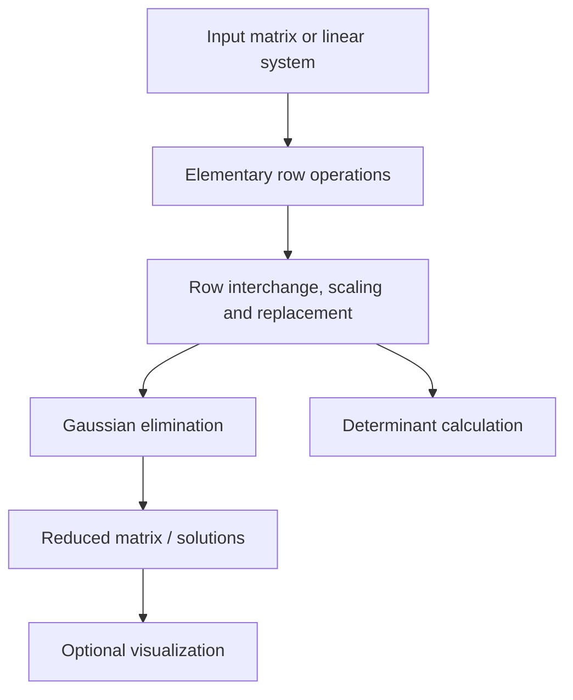

# Linear Solver — Gaussian Elimination and Matrix Operations

**Applied linear algebra · NumPy · Jupyter Notebook**

A notebook-based course project exploring elementary row operations and their use in solving systems of linear equations and computing matrix determinants.

## Method overview



## What is in the notebook?

According to the introduction in [`LA.ipynb`](./LA.ipynb), the assignment covers:

1. Row scaling, replacement, and interchange.
2. Applying those operations to solve a linear system.
3. Computing determinants.
4. Optional plotting of the resulting solution.

The notebook imports `NumPy` and `Matplotlib`, and it contains the implementation and interactive examples.

## Run or review

```bash
git clone https://github.com/Parand1khalili/LinearSolver.git
cd LinearSolver
python -m pip install numpy matplotlib jupyter
jupyter notebook LA.ipynb
```

Open the notebook and run the cells in order. The output depends on the particular example matrices used in the notebook. No new numerical result is claimed here because the notebook has not been re-executed in a fresh environment.

**Scope and limitation:** this is an educational notebook, not a production-grade numerical solver. Check singular or ill-conditioned matrices, pivoting rules, and numerical precision separately before relying on the code in other settings.
